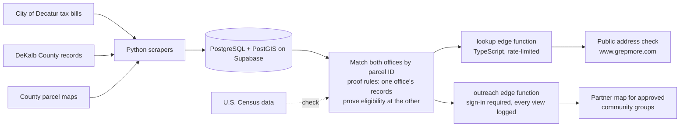

# Senior Homestead Check

**Turning "gotcha" into "we got you" for Decatur seniors.**

Senior Homestead Check helps homeowners in the City of Decatur, Georgia, find property-tax exemptions they already qualify for but haven't claimed, and shows them exactly where to apply. It is our entry in the 2026 Congressional App Challenge for Georgia's 5th District (Rep. Nikema Williams).

- **Live site:** https://www.grepmore.com (English and Spanish)
- **Demo video:** (https://www.youtube.com/watch?v=TmxgNM3zxmE)
- **Built by:** Sai Kakarala and Avi Kakarala, The Paideia School. Mentor: Raghu Kakarala.

## The problem

In Decatur, every exemption has to be claimed separately at two offices, DeKalb County and the City of Decatur. Filing with one does not cover the other, and new senior exemptions (at ages 62, 65, 70 and 80) are never added automatically, even when an office already has proof of the owner's age.

## What we found

Using only public records for all 7,693 Decatur homes:

- **1,259 homes** whose own records show they qualify for an exemption they don't get.
- **About $1.2 million a year** in city property tax those homeowners don't need to pay.
- Our savings math (exempt value × 2026 city tax rate) matched the credits on actual 2026 city bills for 99.8% of GH-1, GH-2, GH-3 and S-3 exemptions.

## How it works

1. **Collect.** Python scrapers download City of Decatur tax bills, DeKalb County exemption and ownership records, and county parcel maps. They are rate-limited and identify themselves so they don't overload public websites.
2. **Match.** Everything is loaded into PostgreSQL. We join the two offices' records by **parcel ID, not by address or owner name**, because the offices spell addresses and names differently and the parcel ID is the one number both share. PostGIS places each parcel on the map.
3. **Prove, don't guess.** We never guess anyone's age or income. A gap is "proven" only when one office's own records already show the owner qualifies and the other office hasn't applied the matching exemption. Exemptions with income tests we can't confirm are labeled "worth checking."
4. **Check.** We compare our counts with U.S. Census data as a sanity check on the tax data.
5. **Serve.** Two Supabase edge functions (TypeScript) power a public address check and a private partner map.

## Repository layout

| Folder | What's in it |
|---|---|
| `scrapers/` | Python scrapers for city bills, county records and GIS parcels, with offline tests (`scrapers/README.md`) |
| `supabase/migrations/` | SQL: the `app` schema, address lookup index, lookup and partner functions, partner map |
| `supabase/functions/` | Edge functions `lookup` (public) and `outreach` (sign-in required) |
| `supabase/load/` | Scripts that load the cleaned data into Supabase |
| `analysis/` | The original database conversion and the gap analysis (proof rules, savings math, data-quality checks) |
| `census/` | Census comparison scripts |
| `site/public/` | The website: plain HTML, CSS and JavaScript, no build step; English and Spanish pages |
| `site/build/` | `build.py`, which generates the findings pages from aggregate data only |
| `docs/` | Research notes |

## Design for older eyes

Large type, high-contrast colors and Atkinson Hyperlegible, a font made for readers with low vision. The partner map uses colorblind-safe colors. Every public page works on a phone and is available in Spanish.

## Privacy

- **No household data is in this repository.** The database, the scraped files and the partner list are not published here.
- The public site never shows owner names, and public maps show only ranges for areas of 10 or more homes.
- Addresses typed into the check are not stored.
- The partner map requires an approved sign-in, and every view and download is logged.
- The Supabase key in `site/public/partners.js` is the public "anon" key, which is meant to be visible; all data access goes through the edge functions.

## Use of AI

Parts of this code were written with help from AI (Claude, by Anthropic). Our Congressional App Challenge application lists where AI was used and what we designed, built, tested and decided ourselves.

## Disclaimer

General information only, not tax or legal advice. Not affiliated with the City of Decatur or DeKalb County. Each office decides every application.

## License

MIT. See [LICENSE](LICENSE).
